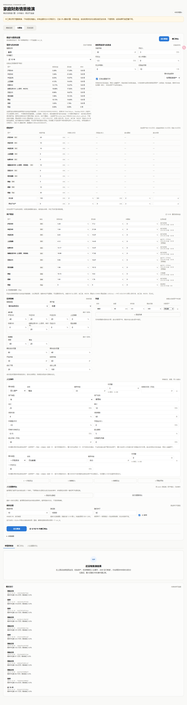
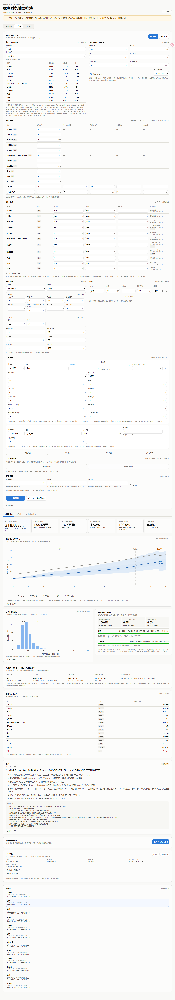
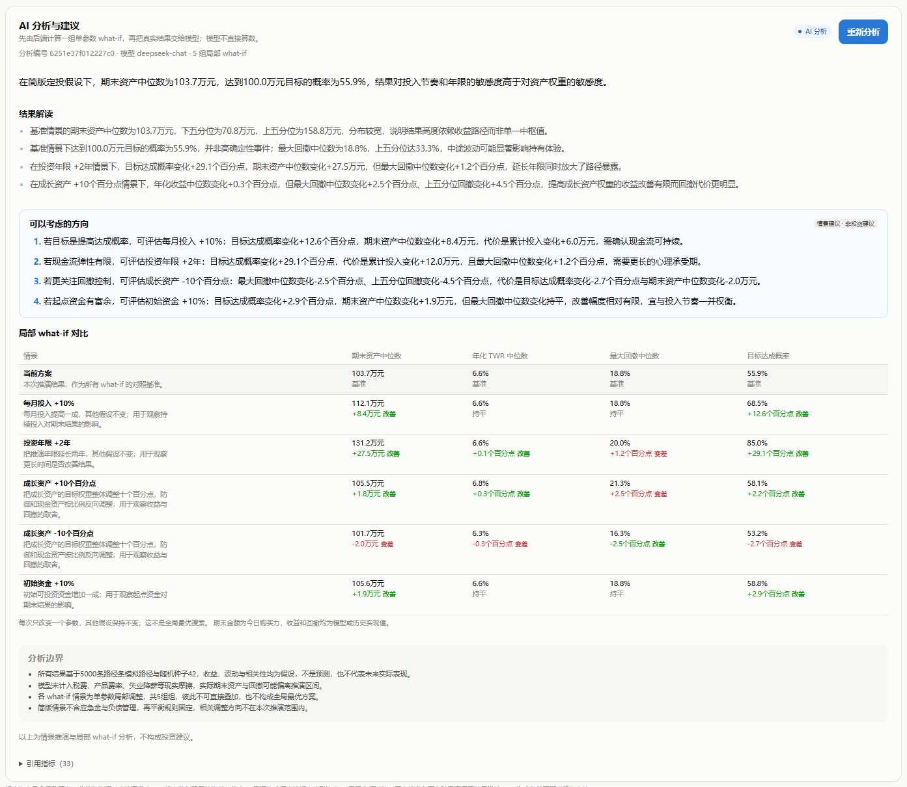
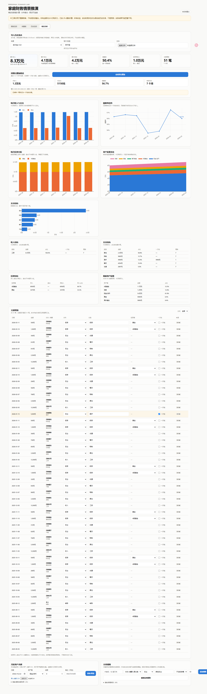
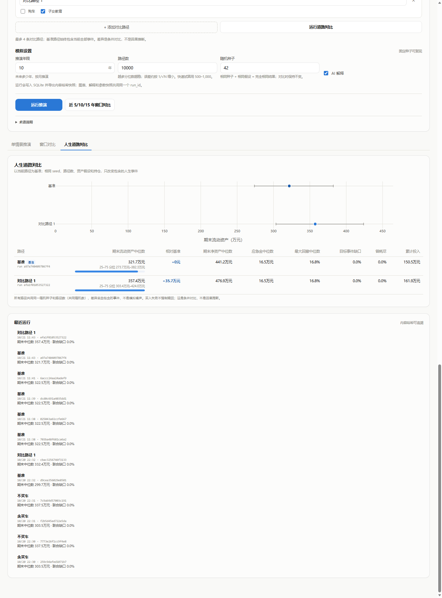
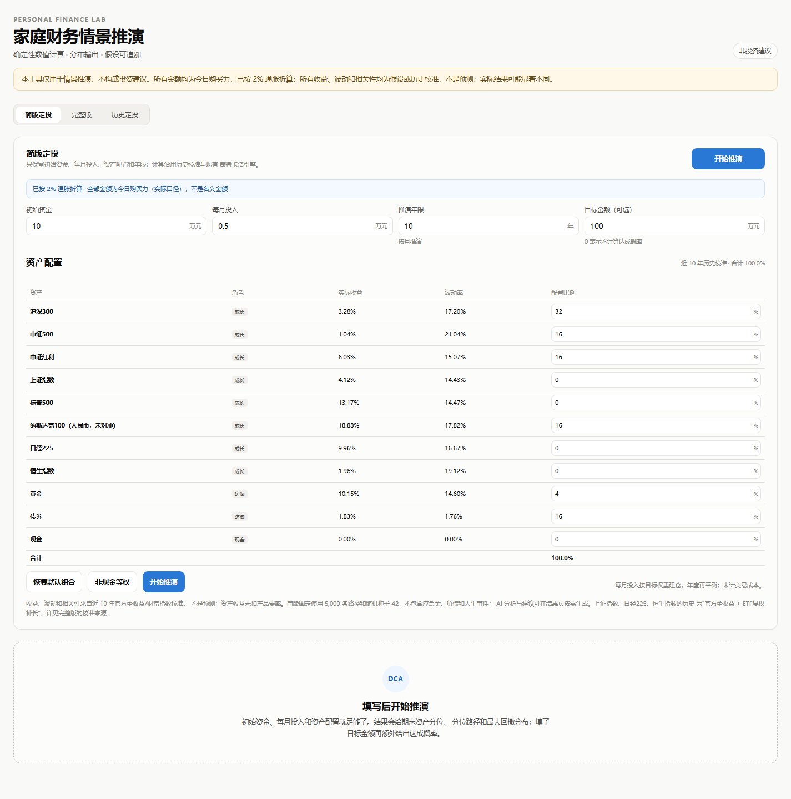
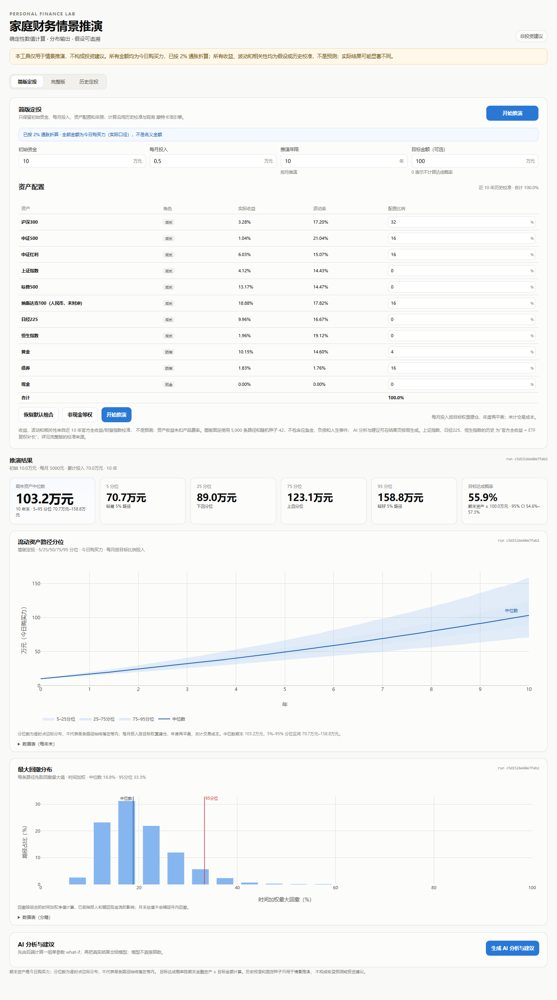
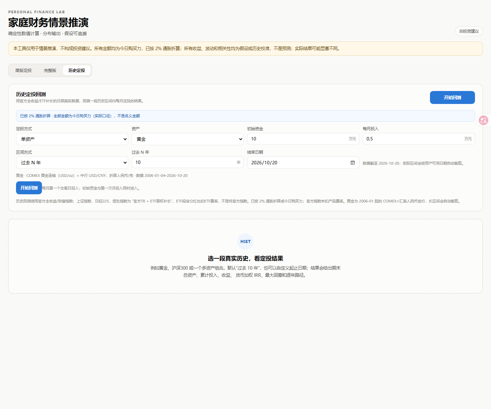
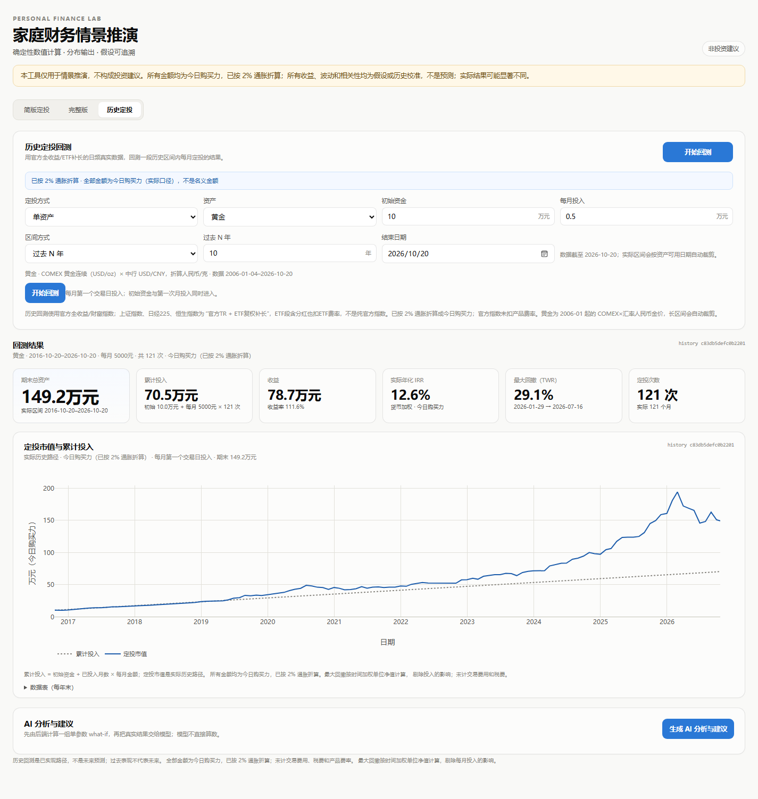

# 家庭财务情景推演

个人/家庭财务的情景推演、定投与收支分析系统。提供四个入口，并在三个投资结果页提供按需 AI 分析与建议：

- **简版定投**：只保留初始资金、每月投入、资产配置和年限，输出期末资产分位、目标达成概率、分位路径和最大回撤。
- **完整版**：给定分类资产负债表、家庭现金流、应急金、历史校准的多资产假设、成长/防御策略和人生事件，输出未来各时点的流动资产分位路径、最大回撤分布、目标事件通过率、期末资产构成，并用大模型做受约束的定性解释；同时支持“人生道路”条件对比（例如买车 vs 不买车）。
- **历史定投**：用官方全收益/ETF补长的日频真实数据，回测过去 N 年或自定义区间的每月定投；输出期末总资产、累计投入、收益、货币加权 IRR、最大回撤和逐年路径。
- **收支分析**：导入支付宝/微信/银行 CSV/Excel，做字段映射、规则分类和手动修正；输出月度收支、储蓄率、支出结构、投资分配和资产配置，并可把最近 12 个月中位数回填完整版。
- **AI 分析与建议**：三个结果页都可以按需生成。后端先计算一组单参数 what-if，再把真实结果交给大模型；建议只涉及情景参数，不推荐具体产品、不给买卖时点，并标注“非投资建议”。

完整版预览：











## 当前状态

已完成：

- 简版定投页：初始资金、每月投入、资产配置、年限、目标金额；复用同一套引擎和历史校准，输出分位、目标达成概率和最大回撤。
- 历史定投页：单资产或多资产组合、过去 N 年或自定义起止日期；官方全收益/财富指数与 ETF 补长的日频真实数据，输出期末资产、累计投入、收益、货币加权 IRR、最大回撤和逐年路径。
- 收支分析页：导入支付宝/微信/银行 CSV/Excel，预览并映射日期、金额、收/支等字段；规则分类 + 手动修正；输出月度收支、储蓄率、支出结构、投资买入/卖出/净投入、资产配置；支持从最近 12 个月中位数回填完整版月收入和月支出。
- 11 类流动资产的初始持仓与历史校准：沪深300、中证500、中证红利、上证指数、标普500、纳斯达克100、日经225、恒生指数、黄金、债券、现金。新增四个指数的默认权重为 0，不直接参与组合；相关矩阵的共同日期会随资产集合略有变化，默认结果可能有小幅差异。
- 家庭应急金：默认 10 个月开销，覆盖月供；月结余先补足应急金再投资。
- 成长/防御分组的随年龄降权益策略，以及恒定比例策略。
- 通用人生事件：一次性支出、持续收入/支出、买房/买车（首付+按揭+月供+维护+租金+指定年限卖出）。
- 人生大事时间窗：买入资产和一次性支出可以设置 0–30 年的窗口；窗口内每月用全部流动资产检查，首次买得起/付得起时执行；窗口末月再试一次，并输出完成时点中位数、25–75% 分位、窗口内/末月/未通过概率和资金构成。
- 初始房产/其他非流动资产与按揭；卖出时从卖出款中偿还剩余本金。
- 期末资产构成、流动资产/净资产/应急金/非流动资产/负债的分位与中位数。
- 人生道路对比：以当前情景为基准，勾选每条路径包含的人生事件（如买车/不买车）；所有路径共用 seed、路径数、资产假设和持仓，只改变事件。
- 历史校准快照、数据版本、内容哈希 run_id、SQLite + JSON 快照、`?run=` 深链接。
- 受约束的 LLM 解释：占位符白名单、禁止裸数字、失败自动回退模板。
- 按需 AI 分析与建议：简版/完整版/历史定投三个结果页都可生成；后端先跑一组单参数 what-if（每月投入/支出、年限、成长资产权重、初始资金、应急金、历史区间/再平衡等），模型只基于这些真实结果给情景建议，不做全局最优搜索。
- 分析结果独立缓存和快照：`analyses` 表 + `runs/analysis-<analysis_id>.json`，包含基准、what-if、引用指标和渲染前模板。

功能二 v1 已完成（导入、规则分类、月度收支/投资结构、回填假设）；剩余平台预设与更细的对账。功能三的 GARCH/FHS、滚动历史窗口分布和历史回撤移植仍未做（当前先做历史区间回测）。

## 简版定投





顶部“简版定投 / 完整版 / 历史定投”切换；首次打开默认简版，选择会记住；`?run=` 深链接直接进完整版。简版只保留：

- 初始资金、每月投入、推演年限、目标金额（可选）。
- 资产种类与配置比例（11 类，0% 表示不配置）。

固定口径：近 10 年历史校准、按目标比例月度投入、年度再平衡、5,000 条路径、种子 42；不包含应急金、负债、人生事件、时间窗和人生道路对比；AI 分析与建议在结果页按需生成。结果给出期末资产 5/25/50/75/95 分位、目标达成概率（期末金融资产 ≥ 目标金额）、分位路径和最大回撤分布。

简版通过 `/api/simple` 映射到同一套 `ScenarioRequest` 和确定性引擎，所以资产收益、波动、相关性口径与完整版一致；不是另一套简化复利公式。

## 历史定投





用官方全收益/财富指数与真实金价的**日频数据**回测一段已经发生过的历史，回答“过去 10 年每月投黄金，到现在怎么样”这类问题。上证指数、日经225、恒生指数在官方数据之前用 ETF 复权净值补长，来源中会明确标出。

- **资产**：10 类风险资产：沪深300、中证500、中证红利、上证指数、标普500、纳斯达克100、日经225、恒生指数、黄金、债券；单资产或多资产组合（按目标比例投入，可年度再平衡或不再平衡）。
- **区间**：过去 N 年，或自定义开始/结束日期；实际区间会按所选资产的可用日期自动裁剪。
- **定投**：初始资金 + 每月第一个交易日投入；初始资金与第一次月投入同时进入。
- **输出**：期末总资产、累计投入、收益、收益率、货币加权 IRR、时间加权最大回撤、期末资产构成、逐年/逐月路径。
- **口径**：今日购买力（按 2% 通胀折算）；官方全收益/财富指数未扣产品费率；未计交易费用和税费。

示例（数据截至 2026-10-20）：黄金，初始 10 万、每月 5 千、过去 10 年，实际区间 2016-10-20–2026-10-20，共 121 次定投；累计投入 70.5 万，期末 149.2 万，收益 78.7 万（+111.6%），货币加权 IRR 12.6%，时间加权最大回撤 29.1%。所有金额为今日购买力（已按 2% 通胀折算），不是名义金额；这是历史实现值，不是未来预测。

上证指数、日经225、恒生指数的历史序列是“官方全收益 + ETF复权补长”：官方数据分别从 2020-07、2023-01、2021-10 起，更早区间用 510210、1320.T、2800.HK 的复权/累计净值；这三类不是纯官方指数，页面和来源字段会标 `ETF补长`。海外指数均按中行汇率折算人民币、含汇率、未对冲。

黄金使用 **COMEX 黄金连续（USD/oz）× 中行 USD/CNY，折算人民币/克** 的 20 年真实金价，不是上金所 Au99.99；它含汇率、未对冲。历史数据来自 `scripts/build_history_data.py` 生成的 `backend/app/data/history.json`（当前数据版本 `5ab6ffa3c2feaf0c`）；应用运行时只读这个快照，不联网。GARCH/FHS、滚动历史窗口分布和历史回撤移植暂未实现，当前先做历史区间回测。

## AI 分析与建议

三个结果页都有“生成 AI 分析与建议”按钮，按需调用，不拖慢推演。流程是：

1. 后端先从已保存的结果读取基准指标。
2. 按页面类型生成一组**单参数局部 what-if**：
   - 简版：每月投入 +10%、年限 +2 年、成长资产 ±10 个百分点、初始资金 +10%。
   - 完整版：每月支出 -10%、年限 +2 年、成长资产 ±10 个百分点、应急金目标 +3 个月。
   - 历史定投：每月投入 +10%、初始资金 +10%、回测起点提前 2 年；组合模式再加再平衡切换和成长资产 ±10 个百分点。
3. 在同一 seed、同一路径数/同一历史数据下重跑这些变体，得到真实的期末资产、目标概率、回撤、IRR 等指标。
4. 把这些结果和指标白名单交给大模型，模型输出 `summary`、`findings`、`suggestions`、`caveats`、`metric_refs`。
5. 后端校验：所有数值必须是白名单占位符、建议必须引用至少一个 what-if、禁止具体产品/买卖时点/收益承诺；失败回退模板分析。

关键边界：

- 每次只改变一个参数，其他假设不变；这是**局部敏感性对比，不是全局最优搜索**，也不把某个变体称为“最佳方案”。
- 建议只涉及页面里能调整的情景参数；简版不会建议应急金/负债，历史页不会建议人生事件。
- 输出带“非投资建议”标注；分析快照包含 `facts`、`variants`、`templates`，可以追溯每个数字来自哪次 what-if。
- 分析失败或模型输出不合规时，返回模板分析并在 `warnings` 中说明，不会把未校验的模型文本直接展示。

## 历史收支与投资结构


顶部“收支分析”是第四个入口，流程是：

1. **导入**：支付宝 CSV、微信 CSV、银行 CSV/Excel 或通用 CSV/Excel。后端自动找表头行，前端预览前几行，你确认日期、金额、收/支、交易对方、商品/摘要等列后再导入。
2. **分类**：导入时先按关键词规则分成收入、支出、投资、转账/不计；投资再分现金/货币、A股基金、海外基金、黄金、债券、其他。你可以在流水表里逐笔改方向、分类、投资桶和“一次性”标记。
3. **汇总**：按月输出收入、支出、结余、储蓄率、一次性收支、投资买入/卖出/净投入；支出和收入按类别汇总；投资按桶汇总买入占比。
4. **资产余额**：手动录入或导入“日期, 资产, 余额”CSV；按月生成资产配置变化图。余额和流水是两套数据，不会用交易流水硬推算市值。
5. **回填完整版**：取最近 12 个月中位数，排除标记为一次性的交易，按 2% 通胀折算成今日购买力，填入完整版的月收入和月支出，并在页面上标明 observed → assumption。

关键边界：

- 原始流水 append-only；手动修改只覆盖分类字段，不改原始行。导入批次可删除，重复文件按指纹去重。
- 规则只影响之后重新导入的交易；改完规则可点“重新应用规则”，手动修改过的交易不会被覆盖。
- 转账、信用卡还款、退款、报销默认不计入收入/支出；如果实际是收入或支出，请手动改方向。
- 分类是规则 + 人工确认，不把完整流水发给大模型；原始文件和数据库都在本机。
- 月度余额需要你自己提供；没有余额快照时，投资结构仍可看买入分配，但资产配置图为空。
- 支出结构图只显示前 9 类，其余归入“其他类别”；完整明细在表格里。
- 银行/平台导出的列名、编码差异很大；当前用表头检测 + 字段映射，样本到位后再加平台预设。

## 架构

```text
backend/app/core/       纯数值计算：收益模拟、策略权重、按揭摊销、事件、引擎、指标、快照、解释约束
backend/app/core/history.py  历史定投回测：日频对齐、月度投入、IRR、TWR 回撤
backend/app/core/advice.py   按需 AI 分析：局部 what-if、建议校验、模板回退
backend/app/assets.py   资产目录、校准快照读取
backend/app/models.py   Pydantic 输入/输出契约（保留旧字段兼容）
backend/app/simple.py   简版定投输入 → 完整 ScenarioRequest 的映射
backend/app/main.py     FastAPI、SQLite、JSON 导出、静态托管
backend/app/data/       calibration.json、history.json
frontend/src/           React + Vite + TypeScript + Plotly
frontend/src/components/SimpleView.tsx  简版定投页
frontend/src/components/HistoryView.tsx 历史定投回测页
frontend/src/components/AnalysisPanel.tsx 三页共用的 AI 分析与建议面板
scripts/fetch_market_data.py  拉取原始序列（需要 akshare/pandas）
scripts/calibrate.py          计算 5/10/15/全历史校准并写入 JSON
scripts/build_history_data.py 生成日频真实全收益历史快照
```

三层职责：

1. **确定性数值层**：`core/` 不联网、不读写数据库；给定请求和随机种子，结果可复现。
2. **交互与追溯层**：FastAPI 校验、持久化、快照；前端只做输入和展示。
3. **解释层**：大模型只接收结构化数值摘要（推演解释）或基准 + 局部 what-if 结果（AI 分析），输出 JSON；数值由占位符在渲染层注入。

## 历史校准与数据口径

当前快照的 `data_version` 是 `4892a300588b45f7`，实际值见 `/api/calibration`，并写入每次运行的 `run_id` 和快照。

| 资产 | 角色 | 序列 | 来源 | 说明 |
|---|---|---|---|---|
| 沪深300 | 成长 | 官方全收益指数 | CSI `H00300` | 分红再投资；未扣产品费率 |
| 中证500 | 成长 | 官方全收益指数 | CSI `H00905` | 分红再投资；未扣产品费率 |
| 中证红利 | 成长 | 官方全收益指数 | CSI `H00922` | 分红再投资；此前版本误用 510880 上证红利，已修正 |
| 上证指数 | 成长 | 官方全收益 + ETF补长 | 上证综合全收益 `000888`（2020-07 起）+ `510210` 上证指数ETF累计净值（更早） | 人民币；ETF段含分红、扣费率；不是纯官方指数 |
| 标普500 | 成长 | 官方全收益指数（USD） | S&P 500 Total Return `^SP500TR` × 中行 `USD/CNY` | 人民币、含汇率、未对冲；未扣产品费率 |
| 纳斯达克100 | 成长 | 官方全收益指数（USD） | Nasdaq `XNDX` × 中行 `USD/CNY` 中间价 | 人民币、含汇率、未对冲；未扣产品费率 |
| 日经225 | 成长 | 官方全收益 + ETF补长 | Nikkei 225 Total Return（2023-01 起官方日频）+ `1320.T` ETF 复权（更早）× 中行 `JPY/CNY` | 含日元汇率、未对冲；ETF段扣费率 |
| 恒生指数 | 成长 | 官方总收益 + ETF补长 | 恒生总收益 `10068`（2021-10 起官方）+ `2800.HK` Tracker Fund 复权（更早）× 中行 `HKD/CNY` | 含港币汇率、未对冲；ETF段扣费率 |
| 黄金 | 防御 | COMEX 黄金连续（USD/oz）× USD/CNY | Eastmoney K-line × 中行中间价 | 折算人民币/克；无分红；含汇率、未对冲；不是上金所 Au99.99 |
| 债券 | 防御 | 中债-新综合财富指数 | 中债财富指数 | 含票息的总收益指数 |
| 现金 | 现金 | 固定实际收益 0% | — | 不是指数，是应急金/现金仓位的假设 |

校准方法：

- **窗口**：近 5 年、近 10 年、近 15 年、全历史。每个资产在自己的可得历史内计算；相关矩阵使用所有资产共同覆盖的月份。
- **收益**：月度对数收益的几何年化，再用 2% 的通胀假设折算成实际收益：
  `real = (1 + nominal) / (1 + 2%) - 1`。
- **波动率**：月度对数收益标准差 × √12。
- **相关矩阵**：共同月份的对数收益相关；现金波动率为 0，相关系数定义为 0。
- **官方全收益口径**：沪深300/中证500/中证红利用 CSI H00300/H00905/H00922；标普500用 `^SP500TR`、纳指100用 Nasdaq XNDX，均按中行 USD/CNY 换算人民币（含汇率、未对冲）；债券用中债-新综合财富指数。上证指数、日经225、恒生指数采用“官方全收益 + ETF复权净值补长”：官方段从各自可得日期开始，更早区间分别用 510210、1320.T、2800.HK 的复权/累计净值；这三类在 `series_type` 标为 `total_return_spliced`，不是纯官方指数。指数收益未扣产品费率，ETF段扣ETF费率。黄金使用 COMEX 黄金连续（USD/oz）× 中行 USD/CNY，折算人民币/克；无分红、含汇率、未对冲；现金不是指数，是 0% 实际收益假设。
- **样本覆盖**：黄金从 2006-01、标普500 人民币从 2006-01、恒生 2008-01、日经 2009-01、纳指人民币 2010-01、上证 ETF 补长从 2011-01 开始。全历史相关矩阵是“所有资产共同可用的 188 个月”（约 2011-01 到 2026-09），受上证指数 ETF 补长起点限制；5/10/15 年窗口均完整。校准 JSON 仍保留 `is_short` 标记机制。
- **10 年实际收益（2% 通胀折算）**：沪深300 3.28%、中证500 1.04%、中证红利 6.03%、上证指数 4.12%、标普500 13.17%、纳斯达克100 18.88%、日经225 9.96%、恒生指数 1.96%、黄金 10.15%、债券 1.83%。这是特定窗口的实现值，不是预测；海外指数均为人民币、含汇率。
- **历史不是预测**：10 年窗口里纳斯达克100 和黄金的实际收益很高，A 股偏弱；窗口差异本身就是敏感性检验，不是“保守/乐观”标签。
- **刷新**：

```bash
pip install -r requirements-calibration.txt
python scripts/fetch_market_data.py
python scripts/calibrate.py
python scripts/build_history_data.py
```

原始 CSV 在 `backend/data/market/`（gitignored），校准 JSON 在 `backend/app/data/calibration.json`，日频历史快照在 `backend/app/data/history.json`。应用运行时只读 JSON，不联网。

## 人生大事时间窗


买入资产和一次性支出都可以设置时间窗；例如“33 岁到 36 岁之间买房”“39.5 岁到 42.5 岁之间准备教育金”。

- **检查频率**：窗口内每个月检查一次“全部流动资产是否 ≥ 首付 + 交易费用/目标金额”。
- **全部流动资产**：投资资产（含现金仓）+ 应急金。两者都会参与检查和扣款；`事件资金顺序`只决定先用哪一部分。非流动资产不会为了凑首付自动卖出。
- **首次通过**：第一个买得起/付得起的月份就执行，不等到窗口结束。
- **窗口末月**：如果之前一直没通过，末月会用全部流动资产再试一次。
  - 买入资产：仍不足则记未通过（首付必须足额）；不会自动卖房。
  - 一次性支出：赎回全部流动资产、支付能支付的部分，剩余记缺口；部分支付算未通过。
- **价格与首付**：窗口内买入价按“年增值/折旧”从窗口起点折算，首付按首付比例同步折算；所以晚买可能更贵（房产）或更便宜（车）。
- **输出**：完成时点中位数、25–75% 分位、窗口内（末月之前）通过率、末月通过率、未通过率、平均实际动用（投资资产/应急金）、通过概率随时间曲线。这些指标同时进入模板解释和 LLM 占位符。
- **卖出年龄**：如果买入资产设置了卖出年龄，必须晚于“最早年龄 + 时间窗”，否则请求会被拒绝。

## 关键假设

| 项目 | 当前实现 |
|---|---|
| 计价口径 | **全部为今日购买力（实际口径）**。历史名义收益按 2% 通胀折算；没有独立的名义层。 |
| 收益分布 | 相关 Student-t（df=5）月度对数收益；年化波动率除以 √12；费用率从收益中扣除。 |
| 资产 | 11 类流动资产 + 房产/其他非流动资产；非流动资产不参与再平衡。 |
| 初始持仓 | 按类别录入；现金中优先划出应急金；剩余可投资资产**保持初始构成**，到再平衡月才调到目标权重；新增月结余按目标权重建仓。 |
| 应急金 | 默认 10 个月 ×（月支出 + 月供 − 非流动资产月租金收入）；月结余先补足；现金流缺口先用应急金；计划性事件默认先用投资资产、后动应急金（可切换）。 |
| 策略 | 恒定比例，或成长/防御/现金分组；降权益只降成长组总权重，组内比例固定；再平衡支持月度/年度/不再平衡；**未计交易成本**。 |
| 负债 | 等额本息；余额、利率、剩余月数；月供进现金流，余额进净资产；关联资产卖出时剩余本金从卖出款偿还。 |
| 人生事件 | 一次性支出、持续收入/支出、买入资产（首付+按揭+月供+维护+租金+指定年限卖出）；买入和一次性支出可设时间窗。 |
| 时间窗 | 窗口内每月用全部流动资产（投资资产+现金+应急金）检查，首次通过即执行；窗口末月再试一次。买入价和首付按年增值/折旧从窗口起点折算。 |
| 买入失败 | 窗口末月首付+交易费用仍不足时，该路径不买入；非流动资产不会自动卖出；记录为未通过。 |
| 一次性支出不足 | 窗口末月赎回全部流动资产并支付能支付的部分，剩余记缺口；部分支付算未通过；无窗口时在开始月执行同样规则。 |
| 卖出所得 | 先补足应急金，再按目标权重投入金融资产；若卖出款不足以偿还按揭，差额从流动资产扣。 |
| 通过率 | 事件当月可用流动资产 ≥ 目标金额的路径占比；联合通过率只统计“目标事件”（买入/一次性），持续收入/支出不参与。 |
| 最大回撤 | 投资组合**时间加权净值**的路径最大值；剔除投入/赎回现金流；不含应急金和非流动资产。 |
| 净资产 | 流动资产（含应急金）+ 非流动资产 − 负债。 |
| 非流动资产 | 房产/车辆按固定实际增长率估值，未建模价格波动；只在指定卖出年龄变现。 |
| 人生道路对比 | 基准路径包含当前全部事件；对比路径勾选包含的事件。所有路径共用 seed、路径数、资产假设和持仓，差异是条件对比，不是因果推断；只比较财务结果，不评价买车等选择带来的效用。 |
| 税费/成本 | 未建模税费和交易成本；官方指数收益未扣产品费率，可在资产假设的费用列补充。纳指100 含汇率、未对冲。 |
| 收入 | 确定性实际增长；未建模失业、降薪、收入与市场相关性。 |

默认情景（30 岁、月收入 3 万、月支出 1.5 万、流动资产 95 万、自住房 150 万、房贷 90 万、10 个月应急金、33–36 岁买车窗口、39.5 岁教育金 30 万）只是演示，不是建议。默认流动资产足以在 33 岁直接买车，所以默认结果里窗口不会产生分化；把目标金额调大或把流动资产调小就能看到逐月通过的分布。

## 运行

### 1. 安装依赖

```bash
pip install -r requirements.txt
```

### 2. 配置环境变量

复制 `.env.example` 为 `.env`，填入 `DEEPSEEK_API_KEY`。默认 DeepSeek 的 OpenAI 兼容接口：

```text
LLM_BASE_URL=https://api.deepseek.com
LLM_MODEL=deepseek-chat
```

`.env` 已在 `.gitignore` 中。没有 key 时系统仍可运行，解释层自动使用模板。

### 3. 启动

```bash
python -m uvicorn backend.app.main:app --host 127.0.0.1 --port 8000
```

打开 `http://127.0.0.1:8000/`。前端已构建时由 FastAPI 直接托管。

开发模式：

```bash
cd frontend
npm install
npm run dev
```

打开 `http://127.0.0.1:5173/`，Vite 会把 `/api` 代理到 8000。

### 4. 测试

```bash
python -m pytest backend/tests -q
```

当前 91 项测试，覆盖零波动年金闭式解、按揭摊销、应急金补足/动用顺序、买入/卖出、买入失败不强制赎回、初始房产卖出偿还按揭、时间窗首次通过/末月通过/未通过、一次性支出窗口、全部流动资产（含应急金）参与首付、非流动资产不自动卖出、简版输入映射与参数校验、目标达成概率、历史定投的常数价格/上涨/回撤/IRR、黄金 10 年回测、组合回测与参数校验、窗口占位符、否定式“不保证收益”、可复现性、内容哈希、校准矩阵 PSD、历史不足标记、四个新增指数的历史回测、微信/支付宝/银行两列金额 CSV 表头检测/分类/汇总/回填、LLM 占位符校验、API 往返、人生道路对比，以及三页 AI 分析的 what-if、缓存、模板回退、建议必须引用 what-if 和裸数字拒绝。

## 可追溯性

每次运行：

```text
run_id = sha256(规范化请求 + 代码版本 + 代码指纹 + 数据版本 + 解释模式)[:16]
```

- 请求里包含 `data_version` 和 `calibration_window`，所以同一组家庭假设、不同历史窗口是两个不同的快照。
- SQLite：`backend/data/finance.db`；推演在 `runs`，历史定投在 `history_runs`，AI 分析在 `analyses`。
- JSON 快照：`runs/<run_id>.json`、`runs/history-<run_id>.json`、`runs/analysis-<analysis_id>.json`，包含请求/结果、what-if、指标引用和渲染前模板。
- 图表、解释和分析都带 `run_id` / `analysis_id`。
- 深链接：`http://127.0.0.1:8000/?run=<run_id>` 直接打开某次快照。
- 参数快照可以展开完整请求和渲染前的解释/分析模板。

## 大模型约束

系统有两类调用，约束不同：

### 推演解释（完整版运行时）

1. 只发送结构化数值摘要（资产、持仓、事件、分位、回撤、通过率、假设、模型边界），不发送原始流水。
2. 输出严格 JSON：`summary`、`bullets`、`caveats`、`metric_refs`。
3. 数值必须写成 `{{metric_key}}` 占位符；后端校验：
   - key 在白名单内；
   - `metric_refs` 与实际使用的占位符完全一致；
   - 文本中不得出现未经占位符引用的阿拉伯数字、百分号、小数或中文数量词；
   - 不得出现买入/卖出/推荐/稳赚等建议措辞；“不保证收益”“不构成承诺”这类否定式风险提示允许。
4. 渲染层用指标值替换占位符；模型永远不直接书写数字。
5. 校验失败、超时、鉴权失败都回退到模板解释，并在运行警告中说明。

### AI 分析与建议（三页按需）

1. 只发送基准结果和后端算好的局部 what-if 结果，不发送原始流水。
2. 输出严格 JSON：`summary`、`findings`、`suggestions`、`caveats`、`metric_refs`。
3. 数值同样只能使用 `{{metric_key}}` 占位符；`metric_refs` 必须与实际使用完全一致。
4. 建议必须引用至少一个 what-if 占位符；只能调整页面里存在的参数，不能推荐具体基金/ETF/股票/平台，不能给买卖时点，不能承诺收益，不能声称全局最优。
5. 校验失败、超时、鉴权失败都回退到模板分析，并在分析警告中说明；模板分析同样带 what-if 表和“非投资建议”标注。

## API

| 方法 | 路径 | 说明 |
|---|---|---|
| GET | `/api/health` | 健康检查、代码版本、LLM 是否启用、数据版本 |
| GET | `/api/calibration` | 完整历史校准快照 |
| GET | `/api/defaults?window=10y` | 默认假设、三档旧预设、校准快照 |
| POST | `/api/simple` | 简版定投：初始资金、每月投入、年限、资产权重、目标金额；返回同一套指标 |
| GET | `/api/history/meta` | 历史定投资产列表、数据覆盖、数据版本 |
| POST | `/api/history/backtest` | 历史定投回测：单资产/组合、过去 N 年或自定义起止日期 |
| GET | `/api/history/runs/{run_id}` | 读取历史回测快照 |
| POST | `/api/cashflow/preview` | 上传 CSV/Excel，返回表头、前几行和建议字段映射 |
| POST | `/api/cashflow/import` | 按字段映射导入流水；原始文件存本机 |
| GET | `/api/cashflow/imports` | 已导入批次列表 |
| DELETE | `/api/cashflow/imports/{import_id}` | 删除批次及其交易、原始文件 |
| GET | `/api/cashflow/transactions` | 交易列表，支持日期/方向/分类筛选 |
| PATCH | `/api/cashflow/transactions/{id}` | 手动修正方向、分类、投资桶、一次性标记 |
| GET/POST | `/api/cashflow/rules` | 读取/新增分类规则 |
| PATCH/DELETE | `/api/cashflow/rules/{id}` | 修改/删除规则 |
| POST | `/api/cashflow/reapply-rules` | 对未手动修改的交易重新应用规则 |
| GET/POST | `/api/cashflow/balances` | 读取/新增月度资产余额 |
| DELETE | `/api/cashflow/balances/{id}` | 删除余额快照 |
| POST | `/api/cashflow/balances/import` | 导入“日期, 资产, 余额”CSV/Excel |
| GET | `/api/cashflow/summary` | 月度收支、分类、投资结构和资产配置汇总 |
| GET | `/api/cashflow/assumptions` | 最近 N 个月中位数，供完整版回填 |
| POST | `/api/analysis` | 按需生成 AI 分析与建议：`{mode, run_id, force?}`；`mode` 为 `simple`/`full`/`history` |
| GET | `/api/analysis/{analysis_id}` | 读取已缓存的分析快照 |
| POST | `/api/runs` | 运行一次完整推演，返回指标、解释和 run_id |
| GET | `/api/runs?limit=12` | 最近运行 |
| GET | `/api/runs/{run_id}` | 读取指定快照 |
| POST | `/api/compare` | 2–5 个情景对比；要求相同 seed、路径数、年限、t 分布自由度和资产顺序；允许事件不同（人生道路对比） |

前端的“窗口对比”会用近 5 / 10 / 15 年三组校准假设和同一组随机路径调用 `/api/compare`；“人生道路对比”会用当前情景加若干事件子集调用同一个接口。

`EventResult` 里的时间窗字段：`window_years`、`window_start_age`、`window_end_age`、`natural_success_probability`（窗口内、末月之前）、`deadline_success_probability`（末月）、`failure_probability`、`median_action_age`、`action_age_p25/p75`、`median_cost`、`funding_investable_mean`、`funding_emergency_mean`、`funding_emergency_share_mean`、`timing`（逐月累计完成概率）。无时间窗的事件这些字段为默认值。

简版示例：

```json
POST /api/simple
{
  "initial_capital": 100000,
  "monthly_contribution": 5000,
  "horizon_years": 10,
  "weights": {"csi300": 0.32, "csi500": 0.16, "dividend": 0.16,
              "ndx100": 0.16, "gold": 0.04, "bond": 0.16, "cash": 0},
  "goal_amount": 1000000,
  "calibration_window": "10y",
  "n_paths": 5000,
  "seed": 42
}
```

历史定投示例：

```json
POST /api/history/backtest
{
  "mode": "single",
  "asset": "gold",
  "initial_capital": 100000,
  "monthly_contribution": 5000,
  "lookback_years": 10,
  "end_date": "2026-10-20",
  "rebalance": "annual"
}
```

AI 分析示例（`run_id` 来自 `/api/simple`、`/api/runs` 或 `/api/history/backtest`）：

```json
POST /api/analysis
{
  "mode": "simple",
  "run_id": "45552df9986c735e",
  "force": false
}
```

## 已知边界与下一步

### 功能二：历史收支与投资结构

已完成第一版：

- 支付宝/微信/银行/通用 CSV/Excel 导入；自动找表头、预览、字段映射。
- 原始流水 append-only；规则分类 + 手动修正；投资桶映射；一次性标记。
- 月度收入/支出/储蓄率、收入/支出结构、投资买入/卖出/净投入、资产余额配置。
- 最近 12 个月中位数回填完整版月收入和月支出（排除一次性、今日购买力）。

尚未做：

- 已用公开样本验证微信、支付宝现代账单和工行信用卡两列金额格式；其他银行列名不固定，仍需表头检测 + 字段映射。
- 自动识别会员/退款/报销/内部转账只能覆盖常见关键词，误判需要手动改。
- 资产余额不会从流水自动推算；需要手动或 CSV 提供月末余额。
- 没有做分类规则的版本迁移；新增默认规则只在新建数据库时种子化，旧库可手动加。
- 还没有多币种账户、信用卡账单周期、投资分红再投资的明细处理。

### 功能三：定投/固定投资分布预测

已完成第一版**历史定投回测**：

- 单资产或多资产组合；过去 N 年或自定义起止日期。
- 日频官方全收益/财富指数，按 2% 通胀折算成实际价格；月度第一个交易日投入。
- 输出期末总资产、累计投入、收益、货币加权 IRR、时间加权最大回撤、期末构成和逐年路径。
- 数据快照由 `scripts/build_history_data.py` 生成，运行时只读 JSON；当前数据版本 `5ab6ffa3c2feaf0c`。
- 黄金从 2006-01（COMEX×汇率）、纳指人民币从 2010-01 开始；长区间会按可用日期裁剪并提示。

下一版再做分布预测：

- 当前完整版/简版的收益模拟是**年度化矩估计**，不是 GARCH/滚动窗口。
- 日频拟合 GARCH（优先 FHS：GARCH 过滤 + 标准化残差重采样），聚合成月频。
- 滚动窗口只作为“历史情景集合/压力测试”，不称为概率分布；重叠窗口的有效独立样本很少。
- 历史重大回撤情景移植只做收益率序列拼接，明确标注为压力测试，不是概率估计。
- 当前校准已使用官方全收益/财富指数（CSI H00300/H00905/H00922、Nasdaq XNDX、中债财富）与 COMEX 金价×汇率；指数未扣产品费率，纳指100 和黄金含汇率、未对冲，现金不是指数。
- 当前 5/10/15 年窗口完整；全历史共同区间受纳指人民币 2010 起点限制。校准 JSON 保留 `is_short` 标记，未来更换数据源时仍可标注历史不足。

### 人生道路对比的边界

- 当前只支持“包含/不包含某个事件”，不支持在同一条对比路径里改事件金额。若要比较“20 万的车 vs 30 万的车”，需要分别修改事件后单独运行，或后续做“复制完整情景”功能。
- 对比只反映现金流和资产结果，不评价买车、买房等选择带来的效用；不能用“终值更高”直接推出“不要买”。
- 所有路径共用同一随机种子，差异不是模拟噪声；但仍然是条件对比，不是因果推断。

### 其他待补

- 新增的上证指数、标普500、日经225、恒生指数默认权重为 0；要纳入组合请在简版/完整版/历史页手动配置，默认结果不会改变。
- 上证指数、日经225、恒生指数是“官方全收益 + ETF复权净值补长”，不是纯官方指数；ETF段含分红但也扣ETF费率，且可能有个股/成分差异和跟踪误差。
- 标普500、日经225、恒生指数按中行汇率折算人民币、未对冲；人民币升值会压低人民币计价收益，模型没有单独汇率过程。
- 简版固定使用近 10 年校准、年度再平衡、5,000 条路径和种子 42；要改校准窗口、路径数、再平衡或加入应急金/负债/事件，请切到完整版。
- 简版的目标达成概率按“期末金融资产 ≥ 目标金额”计算，不是路径中途的目标事件；需要中途目标请用完整版的时间窗事件。
- 历史定投输出的是已实现路径和实际结果，不是未来分布；GARCH/FHS、滚动历史窗口和回撤移植下一版再做。
- 多资产历史回测按交易日并集 + 前向填充对齐不同市场日历；年度再平衡不计交易成本和税费。
- AI 分析的 what-if 是**单参数局部对比**，一次只改一个假设，不能反映参数之间的交互，也不是全局最优；建议需要结合完整情景和自身约束判断。
- what-if 只重跑推演或历史回测，不改历史校准、资产收益/波动假设和数据版本；因此它回答“如果只调这个参数会怎样”，不是“未来会怎样”。
- 模型输出不合规、超时或未配置 key 时，会回退到模板分析；模板建议同样是局部对比，不是最优方案。
- 时间窗目前只用于买入资产和一次性支出；持续收入/支出仍按开始/结束年龄连续生效。
- 窗口末月买入仍不足时不自动卖出非流动资产；如需“卖旧房换新房”，要显式给旧房设置卖出年龄，或后续增加“事件可动用资产”开关。
- 窗口内买入价和首付按固定年增值/折旧折算，未建模房价/车价的随机波动。
- 窗口通过率是“不做行为调整”的条件概率；提前攒钱、延后目标、改变首付比例等策略需要另建情景。
- 收入冲击、失业、收入-市场相关性。
- 税费、交易成本、再平衡摩擦。
- 名义层与通胀过程；当前只用 2% 假设做历史折算。
- 房产/车价随机过程；当前是非流动资产的固定增长率。
- 非流动资产的自动变现；当前只按指定卖出年龄。
- 多币种与汇率对冲；纳斯达克100 当前是 XNDX 美元全收益按中行 USD/CNY 换算的人民币、未对冲；没有多币种账户或对冲工具。
- 前端 Plotly 包体积优化（当前约 5 MB，本地使用可接受）。

## 安全与免责

- `.env` 不提交；API key 只在服务端使用，不出现在代码、日志、快照或前端。
- 运行快照和分析快照包含家庭财务假设、what-if 结果和模型原文，默认只存本机；不要公开分享 `runs/` 目录。
- 收支导入的原始文件存在 `backend/data/imports/`，交易和规则存在 `backend/data/finance.db`；两者都在 gitignore 内，不会发给大模型。
- `import_samples/` 只用于本地样本，已在 `.gitignore` 中忽略；不要放真实姓名、卡号、身份证或密码。
- 如果 key 曾经出现在聊天记录或截图中，建议轮换。
- 本工具仅用于情景推演，不构成投资建议。所有收益、波动和相关性均为假设或历史校准，不是预测；实际结果可能显著不同。
